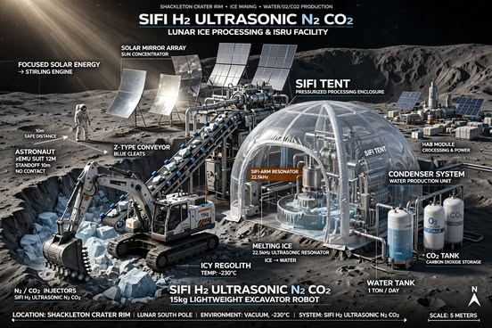

# 🌕 Lunar Pyramid ISRU: Zero-Operating-Cost Water Production
**A Sustainable Water Plant & Commercial Anti-Static Solution**

---

## 👤 Participant Information
*   **Project Name:** Lunar Pyramid ISRU (In-Situ Resource Utilization)
*   **Participant:** SIFI BOUKHARI
*   **Email:** ssifi1972@gmail.com
*   **Specialization:** Senior Building Technician | QHSE Supervisor
*   **Experience:** 30 Years of Experience in Construction, Quality, Health, Safety, and Environment (QHSE)
*   **Challenge Category:** 
---

## 📖 Project Abstract (The News)
> *"As NASA prepares for the Artemis missions, the cost of hauling water from Earth to the Moon remains a staggering $5,000 per kilogram. **Lunar Pyramid ISRU** offers a radical solution. By applying 'Passive Engineering'—utilizing lunar vacuum, gravity, solar heat, and shadow cold—this project designs a self-sustaining plant producing **32.4 tons of water annually** at near-zero operating cost. With a capital investment of **$50 million**, it achieves full ROI in less than 6 months, saving NASA **$1.57 billion over 10 years**. Furthermore, this project introduces a **Dual-Use Commercial Innovation**: the 'Puzzle Grounding Mat'. Originally designed to protect lunar equipment from electrostatic dust, this mat is ready to be supplied to NASA's terrestrial laboratories (JPL), hospitals, and MRI rooms, solving a global electrostatic nightmare. Built with a QHSE-first mindset, this project is the cornerstone for sustainable space exploration and terrestrial safety."*

---

## 🚀 Technical Specialization & Multidisciplinary Approach
*   **Mechanical Engineering:** Micro-Poclain (70cm bucket), Ultrasonic/N₂ excavation, and Z-Type Belt Conveyors.
*   **Thermal Engineering:** Rotary retort, solar concentration, and Vortex Condensers.
*   **Material Science:** Biochar, Ceramic, and Mylar for dust mitigation and thermal insulation.
*   **QHSE & Safety:** 30 years of expertise applied to passive grounding, safety baffles, and zero-hazard operations.
*   **Space Economics:** Open-source Python financial modeling to prove ROI and break-even analysis.

---

## 📌 The Idea in One Line
Instead of hauling water from Earth, we scrape lunar ice, fracture it using ultrasonics and N₂, heat it with the sun, condense it with natural cold, and transport it using gravity. A 24/7 self-sustaining factory.

---

## 🧩 Integrated Cycle (How It Works)
1. **Smart Prospecting & Excavation:** A Micro-Poclain equipped with a **Thermal Sensor** (detects ice veins), **Ultrasonics** (reduces friction), and **N₂/CO₂ Injection** (thermal shock to fracture hard ice).
2. **Transport:** **Z-Type Belt Conveyors** (4 segments for 150m depth), enclosed to prevent dust.
3. **Heating:** A rotary retort at the base of a **transparent tunnel (3×5×50m)**, heated by solar power (day) and a Kilopower reactor (night).
4. **Condensation:** Vapor rises to the cold, inclined apex, condensing on a **Vortex Condenser**.
5. **Dual Storage:** **Strategic Ice** in shadowed silos (-200°C) and **Liquid Water** in insulated tanks.
6. **Dry Regolith Management:** Robot spreads dry regolith to dry, then pushes it out to the **Glass & Block Factory**.

---

## 🛡️ Safety, Dust Mitigation & UV Neutralization (QHSE Focus)
*   **Pressure & Safety:** Tunnel entrances have overlapping (Biochar + Ceramic + Mylar) baffles (20cm long, 8cm overlap). The robot uses a **Horizontal Beam** to lift the baffles upon passage.
*   **UV Photoelectric Neutralization:** Instead of relying on chemical gels (researched since 2005), we use **UV-C light** in controlled airlock chambers. UV photons excite electrons on dust particles (Photoelectric Effect), neutralizing their charge and causing them to fall via gravity. This is powered by lunar solar UV radiation.
*   **Crew Protection:** An independent **Over-suit Garment** (Biochar + Space Silicone + Ceramic + Mylar) worn over the xEMU suit. It acts as a sacrificial, conductive layer ($12M budget) neutralized via UV.

---

## 💡 Commercial Innovation: The "Puzzle Grounding Mat" (Dual-Use Technology)
To combat electrostatic discharge (ESD) on the Moon, we developed an **Anti-Static Puzzle Mat** made of (Biochar + Silicone + Ceramic + Mylar) interlocking tiles. 

**How it works:** 
The tiles interlock like a puzzle (similar to a remote control battery connection), channeling electrostatic charges to a deep **Earth Pit (40×40×40 cm)** filled with carbon (conductor) and salt (electrolyte), connected to a 1-meter bronze rod.

**Commercial Viability & Supply:**
This technology is not limited to the Moon. It solves a major terrestrial problem. NASA's terrestrial laboratories (JPL), hospitals, MRI rooms, and electronics labs suffer from electrostatic discharge that damages sensitive equipment. We offer this mat as a **Ready-to-Supply Commercial Product** to NASA and global medical facilities. It is a low-cost, high-impact consumable that prevents equipment damage and saves millions in repairs.

---

## 📊 Economics (Feasibility)
*   **Location:** Shallow polar crater (150m depth).
*   **Annual Production:** **32.4 tons of water** + **687 tons of raw materials**.
*   **Total Capex:** **$50 Million** (Includes R&D, launch, logistics, and night reactor).
*   **Opex:** **$0** (solar, gravity, vacuum).
*   **Cost per kg:** **$1,543** in Year 1, dropping to **$154** after 10 years (vs. $5,000 from Earth).
*   **Break-even:** Full ROI in less than **6 months**.
*   **Net Savings:** **$1.57 Billion** over 10 years.

## 🗺️ Roadmap
*   **Phase 0 (Year 1):** Lab validation.
*   **Phase 1 (Years 2-3):** Prototype testing on Earth (JSC-1A).
*   **Phase 2 (Years 4-6):** Pilot landing (Solar-only).
*   **Phase 3 (Years 7-10):** Scaling up + Kilopower reactor (24/7 operations).

## 🤝 Open Source & Call for Contributions
This project is open for scientific review. We welcome scrutiny of physical assumptions. **We are not asking for funding — we are asking for scientific criticism that builds or breaks the idea.**

---
*Note: This project was developed for the NASA Space Apps Challenge. All calculations are based on published NASA LRO datasets and ISRU research.*
